# CyberBlue — Module 08: Vulnerability Management

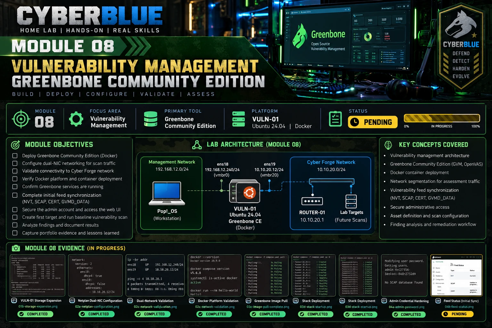

> **Status: BUILD COMPLETE ✓ (technical gate)**
> **Skill:** Discover → Assess → Validate → Prioritize → Remediate → Rescan → Prove Closure
> **Environment:** Cyber Forge / Proxmox VE 9.2.2 | **Scanner:** VULN-01 (VM106) / Greenbone Community Edition
> **Qualification:** Technical Build Gate passed. Independent knowledge/skills evaluation remains separate.

## Principle before platform

**Vulnerability management is a lifecycle, not a scanner report.** Severity describes technical impact under a scoring model; operational risk also depends on asset role, exposure, exploitability, and available controls. A finding should not be declared remediated merely because configuration changed. Validate the exposure independently, make a controlled correction, then **rescan the same target**. Where remediation is deferred, document the risk and constraints explicitly.

```text
ASSET → DISCOVER → ASSESS → VALIDATE → PRIORITIZE → REMEDIATE
                                                      ↓
                       EVIDENCE ← RESCAN ← VERIFY CHANGE
```

### Capability and architecture

| Layer | Role | Input → Output |
|---|---|---|
| Greenbone / GVM | Vulnerability scanner, manager, intelligence feeds | Asset targets / credentials → findings and reports |
| VULN-01 | Scanner VM / Docker Compose host | Management via ens18; scanning via ens19 |
| ROUTER-01 | Policy-routed lab connectivity | Segmented lab traffic / limited WAN egress |
| Linux-Mint | Assessment target (unauthenticated vs authenticated) | Open ports + SSH credential → network and host-level evidence |
| Proxmox + NSM-01 | Visibility and resilience validation | Mirrored ICMP flows → passive packet evidence |

```text
       Home / management: 192.168.12.0/24
                    |
             vmbr0 / ens18
            192.168.12.240
                    |
               VULN-01
              VM106 / GVM
                    |
             vmbr20 / ens19
              10.10.20.12
                    |
         SOC segment 10.10.20.0/24
            |                  |
    ROUTER-01 VM104       Linux-Mint VM101
      10.10.20.1             10.10.20.11
      ens21 WAN                 SSH 22
    192.168.12.100
          |                         mirrored traffic
      Internet               tap104i0 → tap105i1 → NSM-01
```

The lab uses Proxmox bridges, not VLAN tagging. **Management access and scanning traffic are intentionally separate.** Lab egress is allowed through ROUTER-01 with stateful nftables, while direct forwarded access from the SOC subnet to the home LAN is not generally permitted.

---

## Build journal and validated milestones

### 01 — Establish scanner capacity and VM

- Proxmox capacity verified before deployment. VULN-01 provisioned as Ubuntu Server 24.04.5, VM106, 4 vCPU, 8 GiB RAM, initial 60 GiB disk.
- `ens18` on `vmbr0` for management (`192.168.12.240/24`); `ens19` on `vmbr20` for scanning (`10.10.20.12/24`).
- Installer's initially half-sized root LV expanded to consume unused VG capacity, producing ~57 GiB usable root space.

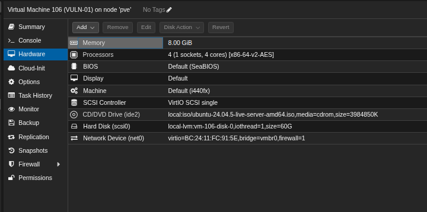
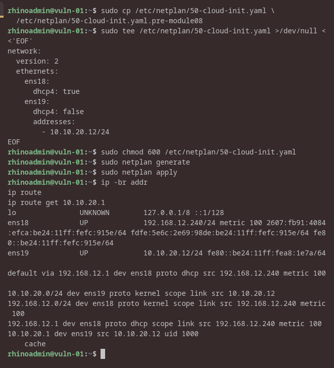

**Validation:** `ip -br addr`, `ip route get 10.10.20.1`, `lsblk`, `df -h /`, `docker --version`.

### 02 — Install and validate Greenbone

- Docker Engine and Compose validated with `hello-world`.
- Greenbone Community Edition Compose definition downloaded from official Greenbone documentation and hashed before image pull.
- Multi-container GVM/OpenVAS stack deployed; administrator password changed without exposing it in shell history.
- Initial feed synchronization required extended time. Confirmed **NVT, SCAP, CERT, and GVMD_DATA all Current** before scanning.

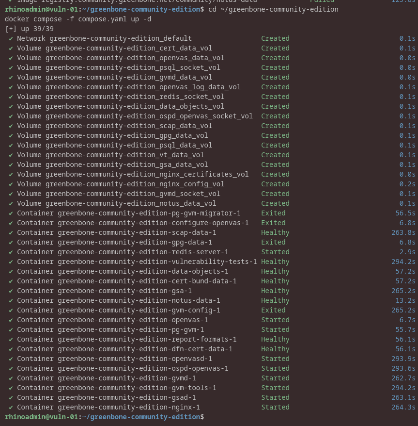
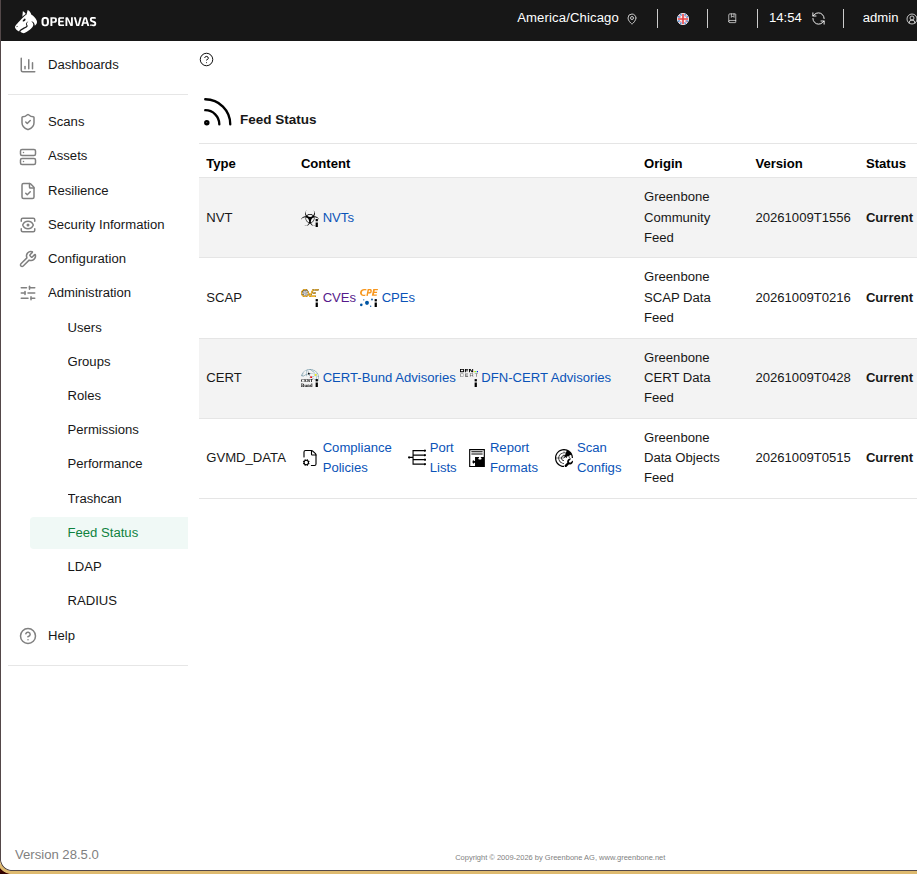

**Validation:** `docker compose ps`, scanner VT-loading logs, GSA feed status. A healthy web interface alone was insufficient: the intelligence feed and scanner state were checked independently.

### 03 — ROUTER-01 baseline / weak SSH MAC finding

- Defined ROUTER-01 at `10.10.20.1`, ran an unauthenticated **Full and fast** baseline.
- Investigated the Greenbone **Weak MAC Algorithm(s) Supported (SSH)** finding using independent SSH algorithm enumeration (`nmap --script ssh2-enum-algos -p22`).
- Reviewed the effective OpenSSH server configuration with `sudo sshd -T | grep '^macs '`. Initial hardening was incomplete; enumeration exposed residual weak algorithms.
- Corrected the supported MAC list, checked the effective SSH configuration and network enumeration, then rescanned **the same ROUTER-01 target**.
- The weak MAC finding was no longer present in the follow-up scan. Other unrelated findings remained and were not falsely claimed as closed.

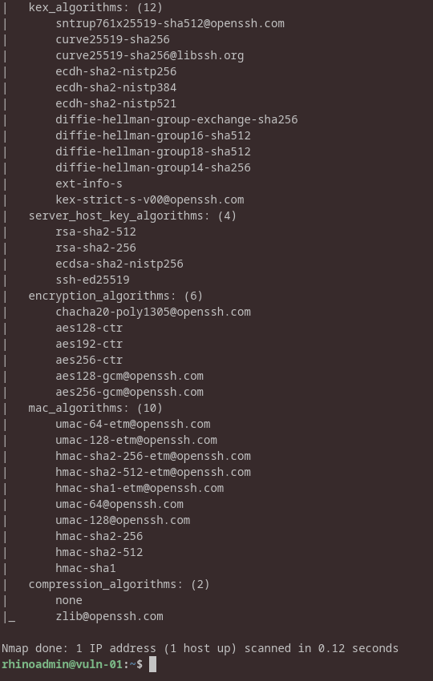
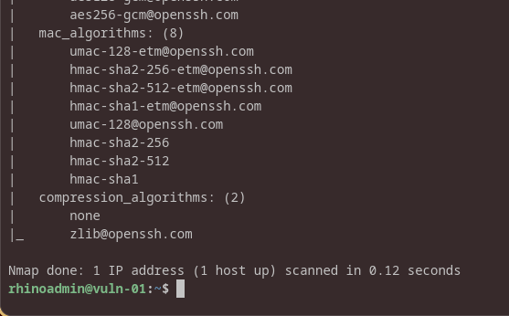
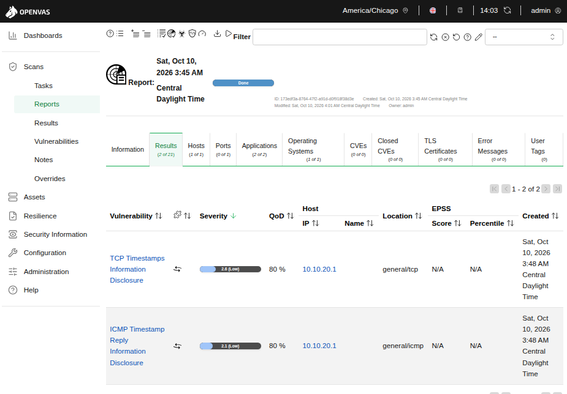

**Qualification:** Validation before and after remediation used independent evidence and a new scanner report—not just a service restart.

### 04 — Linux-Mint unauthenticated versus authenticated

A fair comparative baseline was captured **after OpenSSH was installed** so that the host state did not change between the comparison scans.

| Measure | SSH-enabled unauthenticated | SSH-key authenticated |
|---|---:|---:|
| Report results | 22 | 118 |
| Detected applications | 2 | 31 |
| Medium findings | 0 | 2 |
| Low findings | 3 | 3 |
| CVE records | 1 | 6 |
| Successful SSH authentication proven | Not applicable | Yes |
| Local Bash version found | Not demonstrated | 5.2.21 |

- Target: `10.10.20.11`; scan profile: **Full and fast**, Min QoD 70 for finding comparisons.
- A dedicated, password-disabled `gvm-scan` account was created with an SSH public key; private key was imported into Greenbone's credential store, **not committed here**.
- Confirmed key-based SSH from VULN-01 without password prompt.
- Greenbone's **SSH Authorization Check** and **SSH Login Successful For Authenticated Checks** both confirmed access.
- The **GNU Bash Detection (Linux/Unix SSH Login)** artifact confirmed `GNU bash 5.2.21` at `/usr/bin/bash`, proving authenticated host-level command execution.

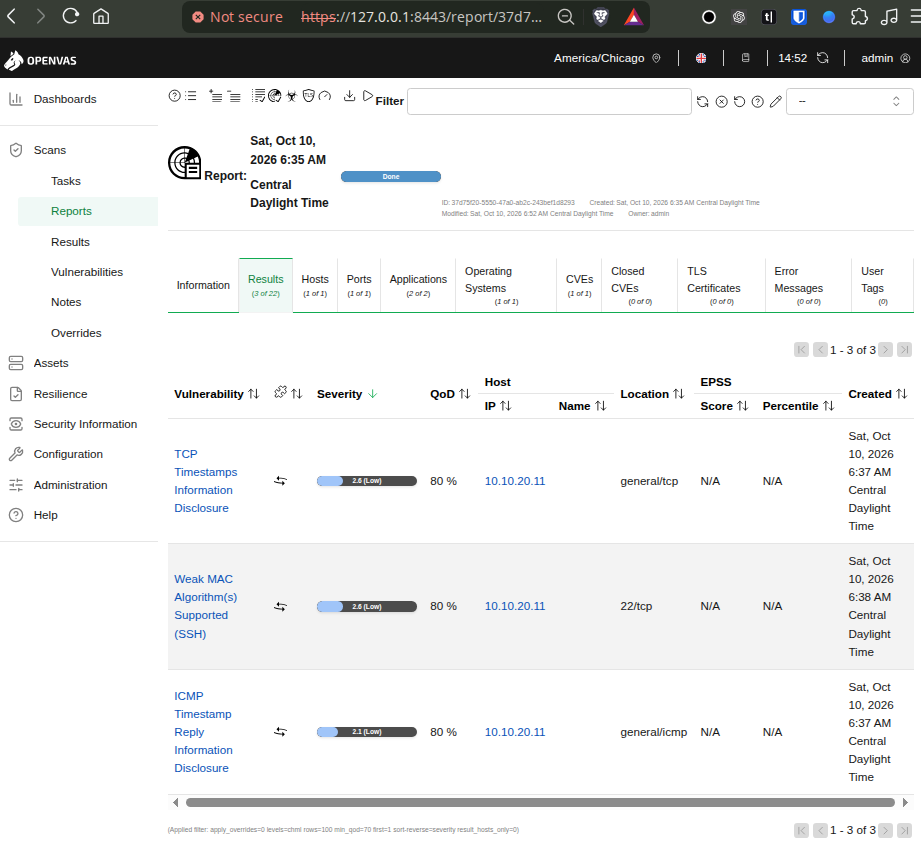
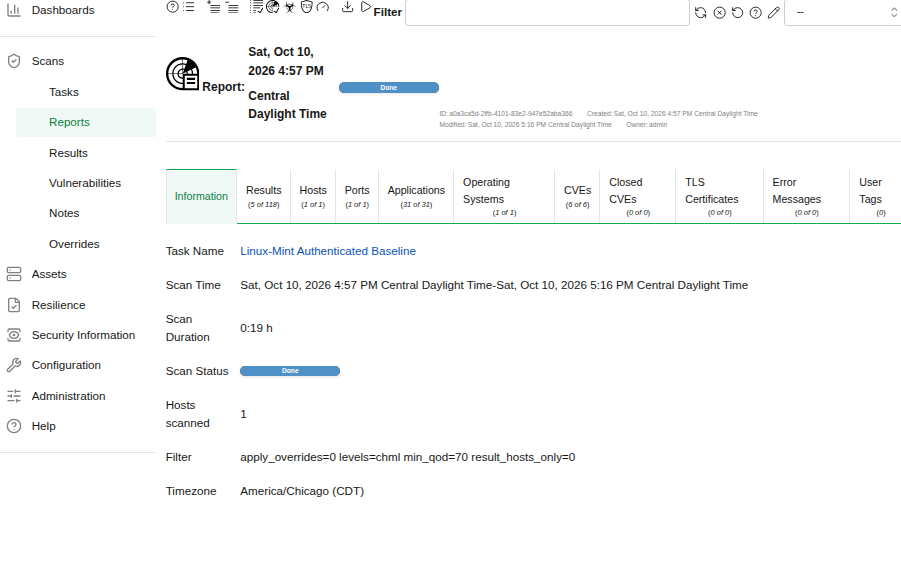

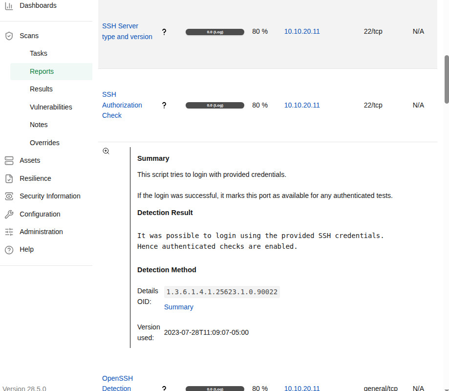
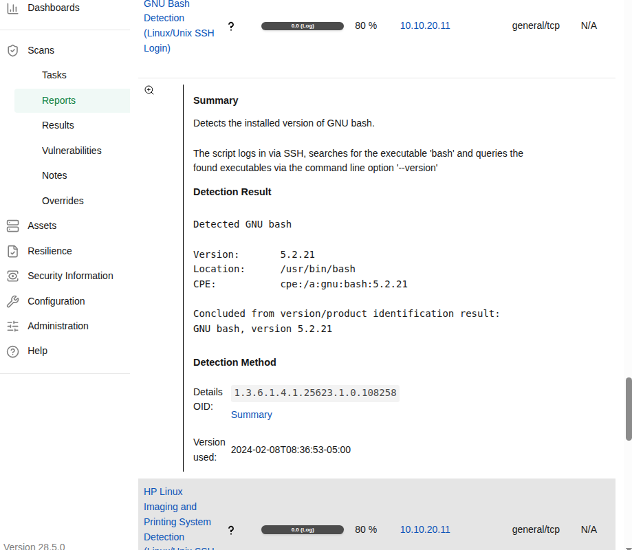

**Lesson:** More reported findings do not necessarily mean the host grew less secure—authenticated assessment increased visibility. Result counts mix security findings and informational/log evidence, so comparison uses both the findings and the direct authentication/inventory proof.

### 05 — Diagnose routing, NAT, DNS and storage constraints

- Linux-Mint initially had no Internet route; `ROUTER-01` had no active WAN route. Added WAN `ens21` on `vmbr0` and obtained `192.168.12.100/24` via DHCP, upstream gateway `192.168.12.1`.
- Enabled scoped nftables forward/NAT egress for `10.10.20.0/24`, maintaining default-drop segmentation and excluding forwarded destination `192.168.12.0/24` from the allow rule.
- Fixed rule-order defect where a terminal `counter drop` was reached before the new allow rule.
- Solved Linux-Mint's broken DNS domain selector (accidentally entered `~,` instead of `~.`) with systemd-resolved, then persisted default gateway/DNS with NetworkManager.
- VULN-01's root filesystem filled during Greenbone feed import: 57 GiB root at 100% with Docker volumes ~38.56 GB. Gracefully stopped Greenbone, enlarged VM106 disk 60 → 100 GiB, grew `/dev/sda3`, LVM PV/LV and ext4 online. Final usable `/` ~97 GiB, 55 GiB used, 38 GiB available (59% used); Greenbone started again and feeds returned to Current.
- **Capacity watch:** Proxmox `local-lvm` thin pool was ~81.47% used when checked; its aggregate virtual allocations are overcommitted. Monitor actual thin-pool use; a VM disk resize does not provision extra physical space.

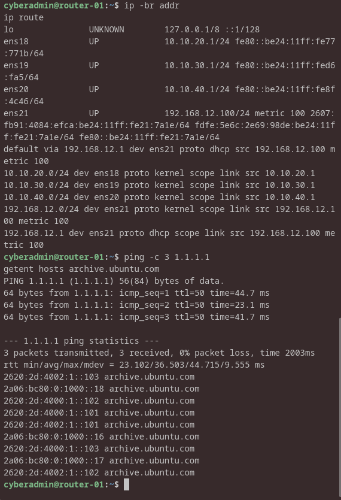
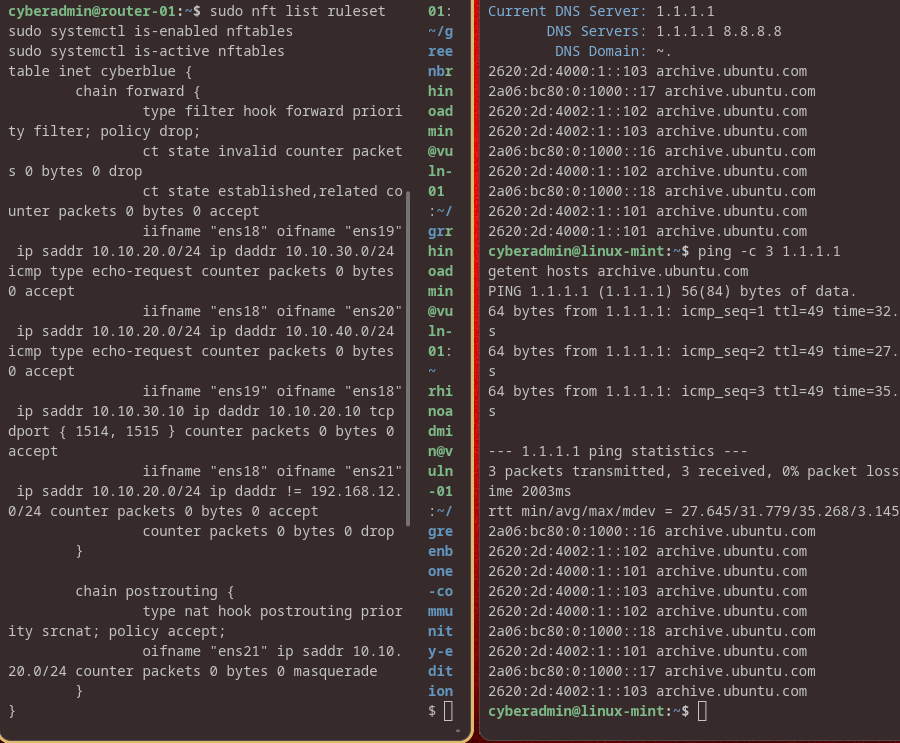
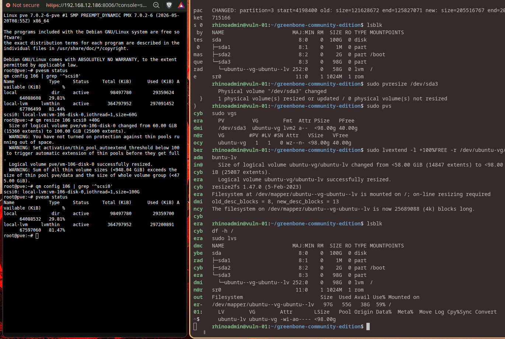
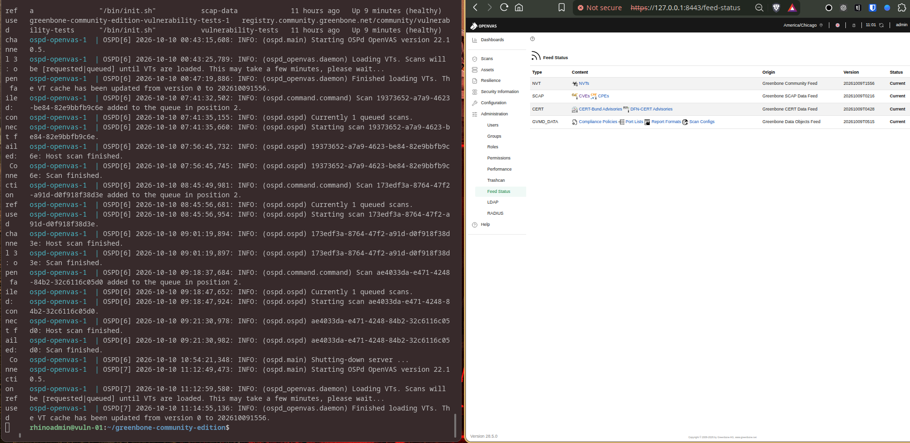

See [`configs/router01-netplan.yaml`](configs/router01-netplan.yaml) and [`configs/router01-nftables.conf`](configs/router01-nftables.conf). Validate these lab-specific rules before applying to any other host.

### 06 — Investigate two open Medium kernel findings

**Do not claim these were remediated.** The authenticated Greenbone scan reported Linux kernel MDS (5.6 Medium) and speculative store bypass / SSB (5.5 Medium) mitigation limitations.

| Check | Linux-Mint guest | Proxmox host |
|---|---|---|
| MDS | `Vulnerable: Clear CPU buffers attempted, no microcode; SMT Host state unknown` | `Mitigation: Clear CPU buffers; SMT vulnerable` |
| SSB | `Vulnerable` | `Mitigation: Speculative Store Bypass disabled via prctl` |
| CPU view | `QEMU Virtual CPU version 2.5+` / KVM, guest kernel `6.14.0-37-generic` | Intel Core i7-3960X; VM101 CPU `x86-64-v2-AES` |
| SMT | Hypervisor state unknown to guest | `/sys/devices/system/cpu/smt/active=1`, `/control=on` |

**Disposition:** Open residual risk / further host-level mitigation assessment. The host reports SMT vulnerable for MDS. A guest's lack of exposed microcode does not establish the physical host's microcode state. A host `prctl` mitigation is not necessarily globally active for every process. Remediation could involve microcode/host kernel analysis, VM CPU exposure review, and SMT tradeoff evaluation under a separate change plan—not an untested live modification here.

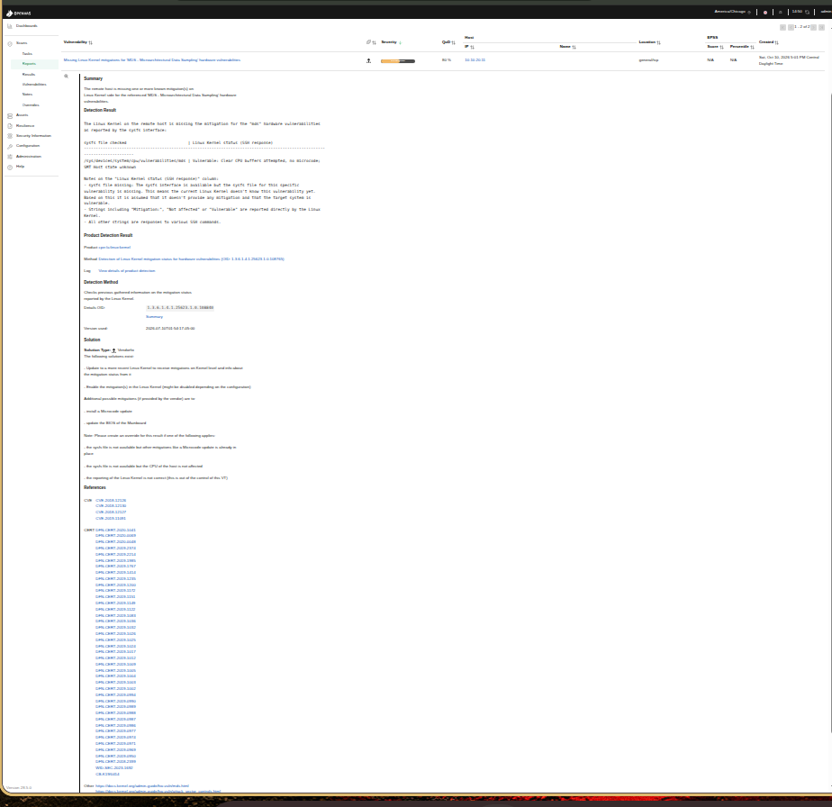
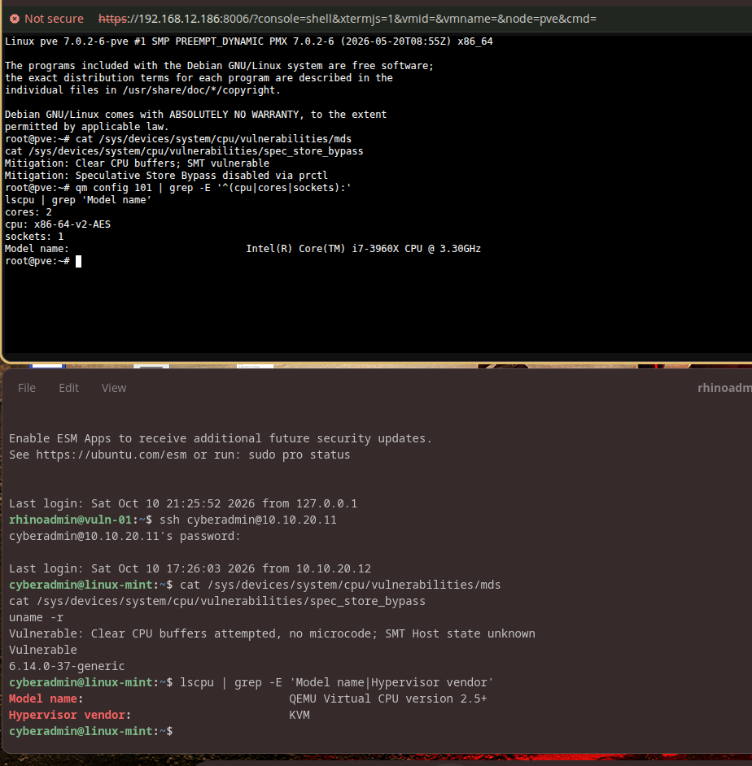
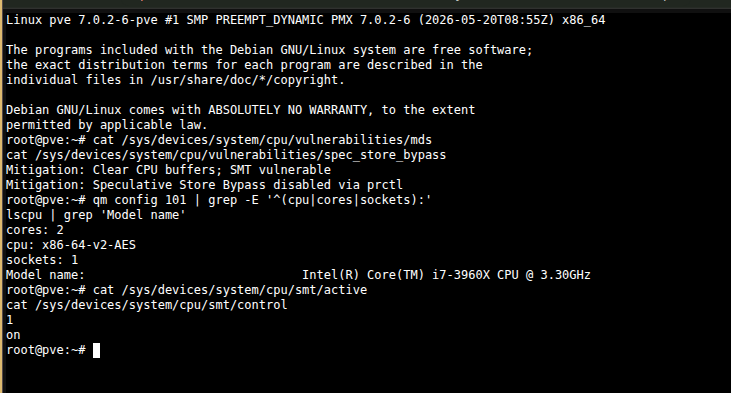

### 07 — Validate reboot persistence and monitoring recovery

- Linux-Mint reboot: retained `10.10.20.11/24`, default gateway `10.10.20.1`, DNS `1.1.1.1`/`8.8.8.8`, active SSH, working name resolution.
- ROUTER-01 reboot: `ens21` up on DHCP, default route via `192.168.12.1`, nftables service active, persistent forward/NAT rules, Linux-Mint Internet reachable.
- **Failure intentionally preserved:** Linux-Mint could ping ROUTER-01, but NSM-01 `ens19` initially captured **0 ICMP packets** after ROUTER-01 reboot. A healthy routing capability was not proof of a healthy monitoring capability.
- Restarting the `cyberforge-vmbr20-mirror.service` manually rebuilt bindings to `tap105i1`, restoring **8 ICMP packets with 0 drops**.
- Extended the Proxmox lifecycle hook to VM104 and VM105 with asynchronous `systemctl --no-block` mirror rebuilds. This covers Proxmox VM stop/start events but **does not guarantee hook invocation for a reboot initiated within a guest**.
- Added a once-per-minute systemd watchdog checking both `tc` mirror filter directions. Deliberately removed the `clsact` qdisc; the watchdog logged a missing-mirror detection and recreated both filters without manual service intervention.
- **Final end-to-end test:** NSM-01 captured **8 packets / 8 received by filter / 0 dropped**, corresponding to 4 ICMP echo requests and 4 replies between `10.10.20.11` and `10.10.20.1`.

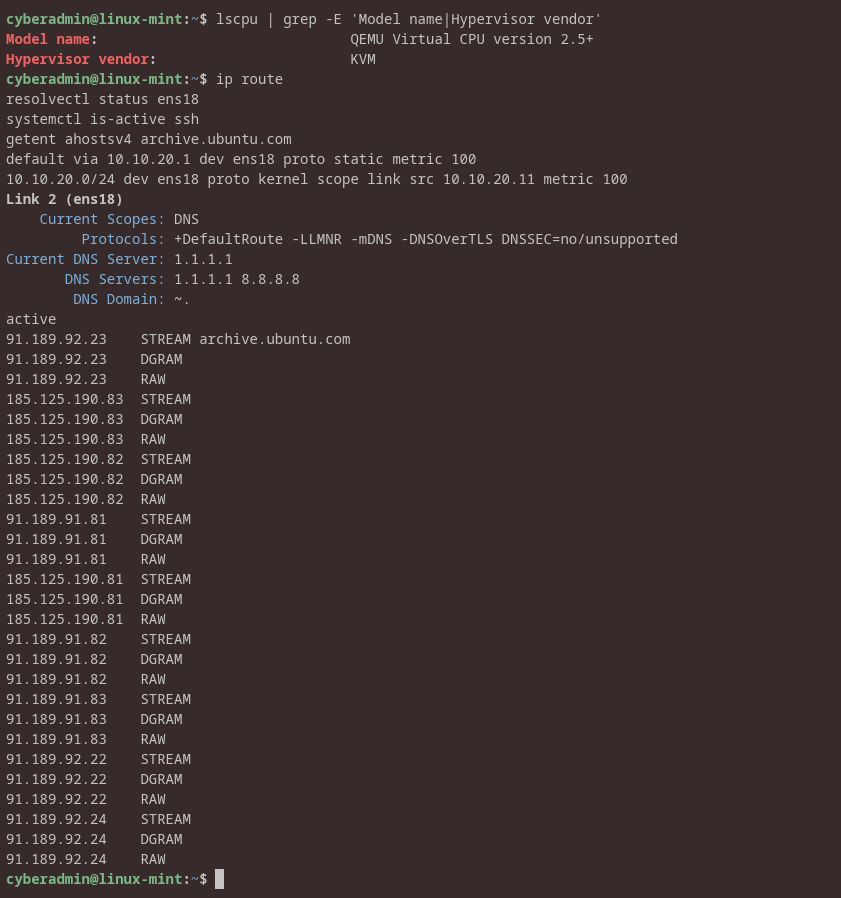
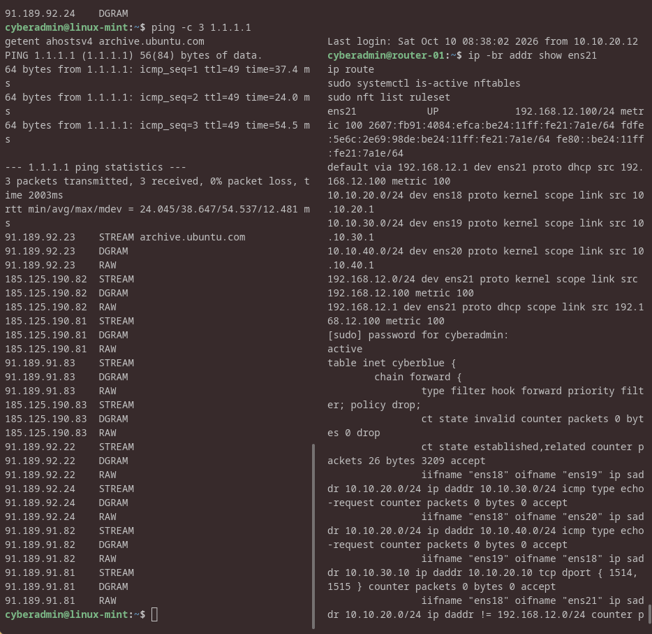
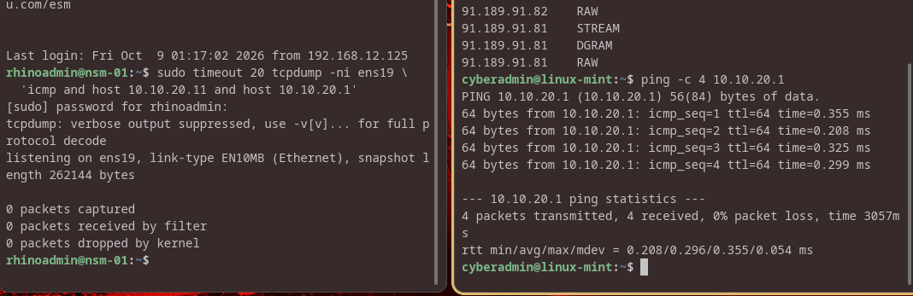
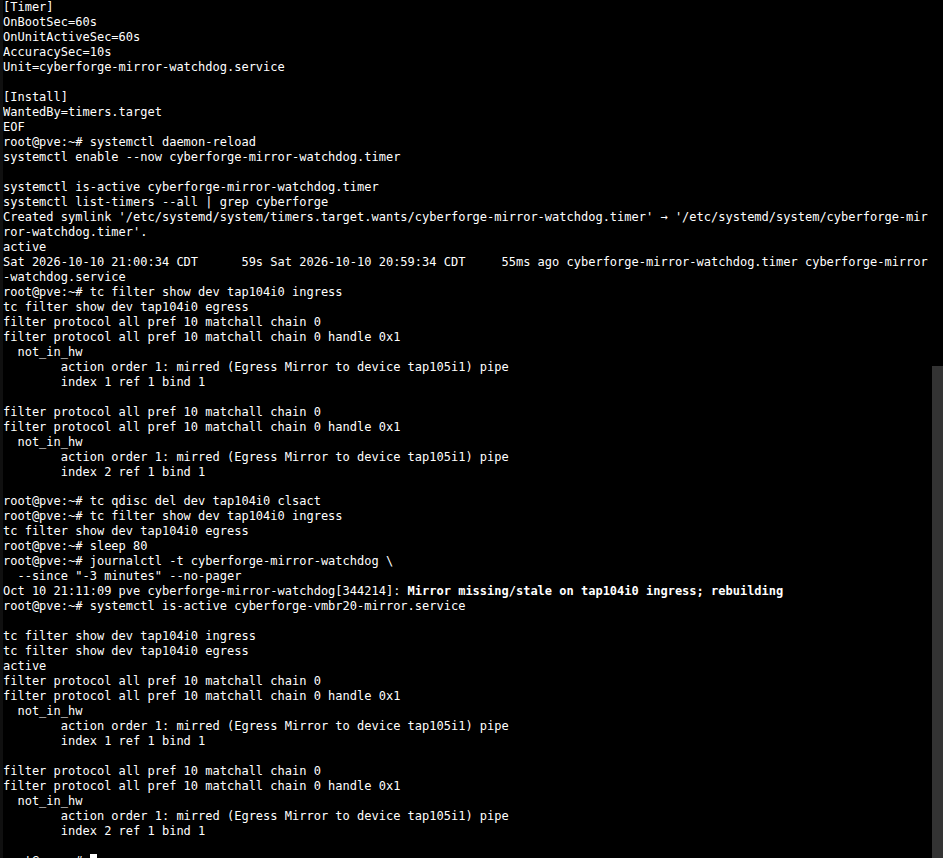
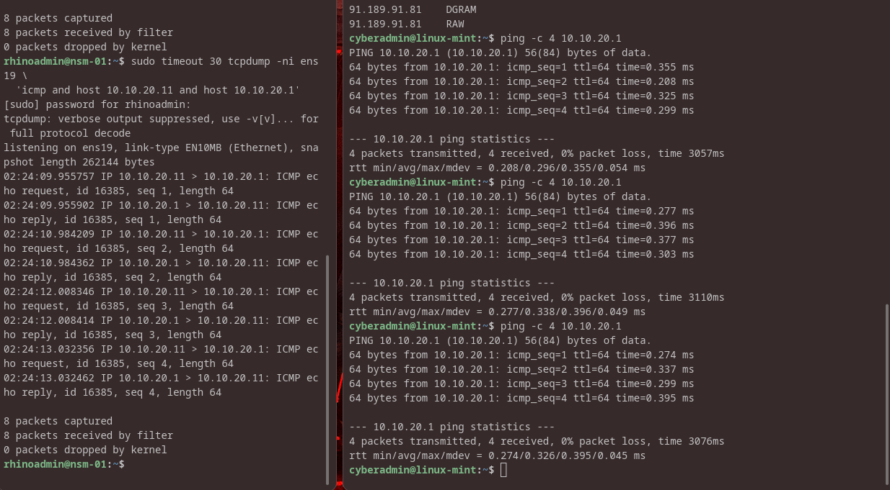

See [`configs/cyberforge-nsm-hook.sh`](configs/cyberforge-nsm-hook.sh), [`configs/cyberforge-mirror-watchdog.sh`](configs/cyberforge-mirror-watchdog.sh), and its systemd [service](configs/cyberforge-mirror-watchdog.service) / [timer](configs/cyberforge-mirror-watchdog.timer).

**Coverage boundary:** The watchdog validates the *presence and textual destination of the `tc` filters*, not that packets are flowing continuously. Automatic recovery was demonstrated after deliberate filter removal; a subsequent **in-guest reboot automatic recovery was not separately exercised**. It remains a regression check for later operations.

---

## Troubleshooting: principle, symptom, test, correction

| Failure | Underlying principle | Observed symptom | Validated correction |
|---|---|---|---|
| Scan intelligence incomplete | Feed readiness ≠ UI availability | Feed categories still syncing | Wait and verify all four Current |
| Router egress absent | Source routing and default route | Lab ping to 1.1.1.1 failed | WAN NIC ens21 / DHCP / default route |
| Forward policy drop | First matching firewall rule wins | NAT present, outbound probes still failed | Place specific forward allow before final drop |
| DNS search selector typo | Resolver policy matters independently of routing | IP ping succeeded; `apt update` DNS failed | Set `~.` and persist NetworkManager DNS |
| Storage capacity exhausted | Data feeds and reports consume disk | VULN-01 100% root | Grow virtual disk, partition, PV, LV and ext4 |
| Monitoring mirror stale | Control plane state ≠ data plane visibility | Sensor running; 0 captured packets | Rebind `tc` mirror; verify 8 ICMP packets |
| Mirror recovery automation | Restore security capability after failure | Removed qdisc broke monitoring | systemd watchdog self-rebuilt both directions |

## Technical Build Gate

| Requirement | Status | Proof |
|---|---|---|
| Dedicated scanner architecture | **PASS** | VM106, dual NICs, Docker stack |
| Feed readiness | **PASS** | NVT, SCAP, CERT, GVMD_DATA Current |
| Baseline assessment and finding validation | **PASS** | ROUTER-01 baseline + independent MAC check |
| Same-target remediation and rescan | **PASS** | SSH weak MAC closure evidence |
| Repeatable unauthenticated baseline | **PASS** | SSH-enabled Linux-Mint scan |
| Authenticated SSH validation | **PASS** | Greenbone authorization + successful login logs |
| Authenticated local inspection | **PASS** | Bash 5.2.21 executable/CPE |
| Findings analysis / risk treatment | **PASS** | MDS/SSB documented as **open**, not falsely closed |
| Scanner/storage recovery | **PASS** | 100 GiB disk expansion and feed revalidation |
| Network config reboot persistence | **PASS** | Mint and ROUTER-01 evidence |
| Controlled monitoring blind spot and repair | **PASS** | 0 packets → mirror restored |
| Watchdog automation plus packet replay | **PASS** | Filter removal → auto-rebuild → 8 packets, 0 drops |
| Separate in-guest reboot watchdog regression | **NOT TESTED** | Explicitly outside technical gate; follow-up operational validation |
| Independent knowledge/skill qualification | **DEFERRED** | Tracked separately after range build-out |

**Technical Build Gate: PASSED — BUILD COMPLETE ✓**
**Risk note:** The MDS and SSB findings remain open for future mitigation engineering. They do not constitute missing evidence for the vulnerability-management capability gate because the objective includes responsible risk disposition, not compulsory zero findings.

## Evidence and portfolio use

Full evidence inventory: **[EVIDENCE.md](EVIDENCE.md)**. Screenshots are genuine lab outputs, not simulations. No private SSH key, password, or scanning credential material belongs in this repository. Banner is a conceptual module visual; factual results are shown in separate evidence captures.

**One-sentence portfolio outcome:** Built and operated a dedicated Greenbone vulnerability-management platform; proved scanner-to-target visibility, independently validated and remediated an SSH configuration weakness, compared authenticated/unauthenticated assessment capability, performed host/hypervisor risk analysis, recovered capacity, and engineered/validated passive monitoring self-recovery after a controlled blind spot.
