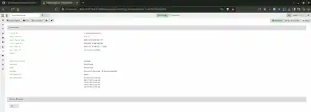

# Module 09 — October 15/16, 2026 Evidence Manifest

**Phase 1 milestone:** Validated. **Full Module 09 qualification:** Open.

This manifest tracks screenshots supplied by the operator in the CyberBlue CyberForge build conversation. They are training-range captures, not immutable forensic disk images. Detailed claims: [October 15 progress](PROGRESS-2026-10-15.md); VQL workbook: [VQL-WINDOWS-BASELINE.md](VQL-WINDOWS-BASELINE.md).

## Evidence categories and image reference labels

| Label | Visual proof / limitations |
|---|---|
| `09ca-dfir-services-listeners` | DFIR-01 mount, three active systemd services, management/client/loopback listeners; Windows relay TCP success |
| `09cb-ssh-shortcut` | RhinoRecon `ssh -G dfir-gui` recognizes local forwarding and SSH auth prompt |
| `09cc-raptor-desktop-icon` | CyberBlue Raptor shortcut icon; launch of both desktop and Start-menu entries confirmed by operator, not independently proven by the screenshot |
| `09cd-windows-msi-completed` | CreateMSI collection completed, MSI plus Config uploaded |
| `09ce-windows-msi-log` | Repack log: Windows AMD64 MSI and 5,913-byte config produced |
| `09cf-rhinotough-msi-hash` | Windows SHA-256 matches original MSI hash via RDP folder transfer |
| `09cg-windows-service` | Velociraptor Windows service Running / Automatic and matching relay leaf TLS fingerprint |
| `09ch-windows-enrolled` | RHINOTOUGH `Connected` and unique Velociraptor client ID |
| `09ci-process-collection` | Windows.System.Pslist completed, 187 rows |
| `09cj-process-raw-results` | Process record attributes, including PIDs/PPIDs and executable paths |
| `09ck-process-vql-parent` | PID 524 investigation returned two children |
| `09cl-process-vql-startup` | Five process records for smss/csrss/wininit |
| `09cm-process-vql-missing-parents` | Zero matches on PID 524, 660, 7920 in 187-row snapshot |
| `09cn-netstat-results` | Windows.Network.Netstat completed, 85 rows |
| `09co-netstat-query-error` | First ESTAB VQL attempt displayed 'Symbol not found' on dotted fields |
| `09cp-netstat-vql-corrected` | Six established TCP connections with local/remote addresses and ports |
| `09cq-services-results` | Windows.System.Services completed, 286 rows |
| `09cr-services-vql` | Four service/process matches |
| `09cs-tasks-results` | Windows.System.TaskScheduler completed, 257 rows |
| `09ct-tasks-vql-page1` | Script/LOLBins regex candidate tasks page 1 of 2 |
| `09cu-tasks-vql-page2` | Candidate tasks page 2 of 2, includes Windows device registration false positive |

## Sensitive-exposure exclusions

**Intentionally excluded from public GitHub:** any screenshots showing the full client configuration YAML, CA/private-key blocks, nonce, embedded credentials or MSI configuration review request. The examples from October 15 around the **CreateMSI CustomConfig / Review request screens** are not admissible for public publication. Full screenshots of unrelated desktop/personal applications should be cropped to the Velociraptor / diagnostic context before upload.

- **Never** commit `client.root.config.yaml`, `client.rhinotough.config.yaml`, `server.config.yaml`, generated MSI packages or their `Config` payloads.
- Avoid reproducing client enrollment nonce even when commands printed it.
- Internal lab IPs are part of this already-public architecture; avoid publishing live credentials, access links, session cookies, or internet-facing auth tokens.
- Retain originals privately with file hashes; record which derivative redacted/cropped image is public and which original it came from.
- Not all individual screenshots are forensic proof of each claim; some are troubleshooting checkpoints, UI states or operator reports.

## Repository screenshot publication status

**Committed thumbnail:** [RHINOTOUGH enrollment screenshot](screenshots/2026-10-15/09ch-enrollment-thumbnail.webp) (downscaled copy of the user-supplied Connected client view).



**Complete curated archive:** 34 source-derived screenshot images with individual SHA-256 hashes, prepared separately for import. They are **not all in GitHub yet** until the following workflow is completed from a machine with the downloaded ZIP and a Git checkout.

```bash
git clone https://github.com/AnthonyKSec/CyberBlue.git
cd CyberBlue
bash tools/import-module09-evidence.sh ~/Downloads/CyberBlue_Module09_2026-10-15_EvidencePack.zip --commit-and-push
```

If the repository is already cloned locally, use `git pull --ff-only` instead of cloning. The helper rejects a dirty working tree, validates every screenshot checksum, copies exactly 34 curated WebP files, writes the SHA-256 manifest, and commits/pushes with the user's configured Git credentials. **No private-key configuration screenshots are in the curated archive.**

## Evidence integrity and completeness

Original operator screenshots were received in this conversation; captures are **not automatically copied to GitHub merely by reference to them here**. A gallery link is valid only when its referenced binary appears in the repository. Do not mark a missing screenshot as uploaded. Any screenshot staged to GitHub must have a reproducible SHA-256 manifest and an explicit statement if it has been resized/redacted.

## Portfolio status

- Infrastructure and initial endpoint baselines: **completed / evidence-backed**.
- Controlled threat hunt, complete case report, reset/replay, service recovery failure tests, registry-based persistence: **open**.
- Never characterize this checkpoint as an actual malicious incident, fully qualified DFIR operator badge, or full Module 09 closure.
