# CyberBlue — Module 09: Endpoint Forensics & Threat Hunting

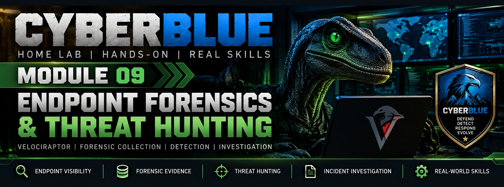

> **Status: IN PROGRESS — Linux endpoint enrolled and baseline collected; Windows physical endpoint enrollment pending**
>
> **Implementation:** Velociraptor DFIR 0.77.3 on Proxmox VE 9.2.2 / Ubuntu Server 24.04.5 LTS
>
> **Historical October 11 checkpoint:** Linux-Mint agent `.deb` transferred and SHA-256 matched; all VMs gracefully stopped for the session. Agent **not yet installed or enrolled**.
>
> **Qualification:** Technical Build Gate **OPEN**. Linux-Mint baseline artifact collections are validated; physical Windows enrollment, controlled threat hunt, full investigation and replay are still pending.


> **Latest progress:** [October 12 validated Linux baseline and physical Windows relay](PROGRESS-2026-10-12.md) · [Evidence SHA-256 addendum](EVIDENCE-NEW-SHA256.txt). Screenshots and troubleshooting documentation are preserved there; Module 09 is **not** build-complete.

## Principle before platform

**Endpoint forensics reconstructs system activity from artifacts, not assumptions or a dashboard.** A working collector is necessary but not sufficient: a defensible investigation must show collection scope, source integrity, event chronology, corroboration, analytical limitations, and reproducible findings. Velociraptor is **one implementation** of that capability.

```text
SCOPE & AUTHORIZE → BASELINE → SIMULATE → COLLECT → PRESERVE
       → INVESTIGATE → CORRELATE → CONCLUDE → REPORT → RESET → REPEAT
```

### Capability, architectural role, inputs, and outputs

| Component | Role | Inputs → Outputs |
|---|---|---|
| DFIR-01 / Velociraptor | Central artifact collection and hunt coordinator | Endpoint requests / trusted agents → forensic results, metadata, client inventory |
| Linux-Mint VM101 | First controlled endpoint | Local process/user/service/filesystem state → baseline artifacts (planned) |
| WIN11-01 VM102 | Future Windows forensic target | Sysmon, Event Logs, scheduled tasks, registry → investigation data (planned) |
| VICTIM-LNX-01 VM108 | Future deliberately vulnerable target | Simulated authorized activity → observable artifacts (not deployed) |
| Ubuntu-SOC / NSM-01 | Existing SIEM and network context | Wazuh, Suricata, Zeek → correlation (not yet performed in this module) |
| Proxmox + ROUTER-01 | Network isolation and storage | Separated management/lab interfaces; scoped routing and VM disks |
| Protected evidence disk | Artifact, data, and case segregation | Collected files → retained evidence and integrity records |

### Current Cyber Forge layout

```text
HOME MANAGEMENT LAN — vmbr0 / 192.168.12.0/24
                    |
             DFIR-01 VM107
         Ubuntu 24.04.5 / Velociraptor 0.77.3
         ens18: 192.168.12.147 (management)
         ens19: 10.10.20.13   (client frontend 8000)
         GUI:   127.0.0.1:8889 (RhinoRecon SSH tunnel)
                    |
              vmbr20 SOC LAB
              10.10.20.0/24
                    |
      Linux-Mint VM101 10.10.20.11
     Debian client installer STAGED ONLY
                    |
   ROUTER-01 10.10.20.1 / nftables segmentation

VM107 scsi0: 24 GiB SSD — OS and application
VM107 scsi1: 150 GiB cyberforge-hdd — ext4 /srv/velociraptor
PVE /dev/sdb: 1 TB shared HDD — ext4 Proxmox directory storage
```

**Design boundary:** The GUI is bound to loopback, not exposed on the home or lab interfaces. Velociraptor's client frontend is bound to the lab IP, not all interfaces. Windows/Victim-zone policy exceptions and real attack traffic **have not** been implemented yet. This project is a contained simulation; real client hunting requires written authorization, credential governance, case isolation, retention and evidence encryption.

---

> **Update (October 12, 2026):** Linux-Mint is now successfully enrolled and returning forensic process, network, account, cron, and service records. DFIR-01's restricted physical-Windows TCP relay is running under a managed non-root systemd account. **Windows enrollment, complete relay reboot testing, and the full hunting qualification remain open.** See [the October 12 checkpoint and evidence gallery](PROGRESS-2026-10-12.md). The original Step 09.38 journal and older qualification table below are historical, not the latest state.

## Initial build journal — historical checkpoint through Step 09.38

### 01 — Capacity, available storage, and HDD repurposing

- Proxmox host: 12 logical CPUs, 31 GiB RAM, ~18 GiB available during preflight. `local-lvm` was **82.71% used**; avoid placing bulk forensic data on this SSD pool.
- Confirmed `/dev/sdb` as Seagate ST1000DM003, 931.5 GiB, serial checked. SMART self-assessment **PASSED**, 0 reallocated/pending/uncorrectable sectors, **37,336 hours** power-on; old media remains a reliability risk.
- Mounted NTFS read-only and inspected contents. After explicit authorization, reformatted only the 1 TB HDD as ext4. `cyberforge-hdd` registered as Proxmox Directory storage supporting VM images, ISO files, backups; **`is_mountpoint 1`** prevents an unmounted directory from being treated as usable storage.
- Proxmox ext4 mount UUID: `c58c58db-4041-4c8d-a9ca-b01c68267aee`; available ~916 GiB. A host reboot mount-persistence test remains pending.

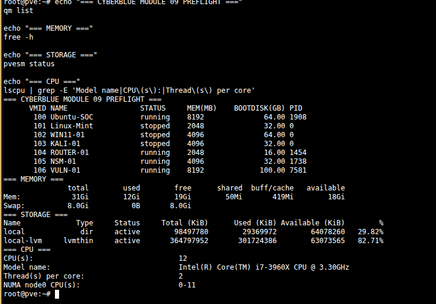
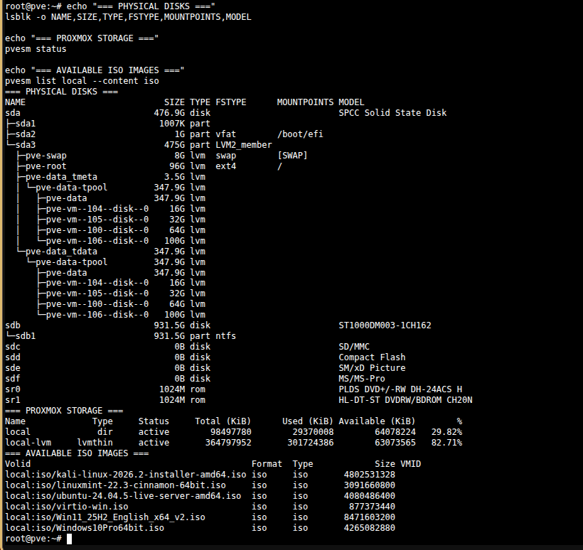
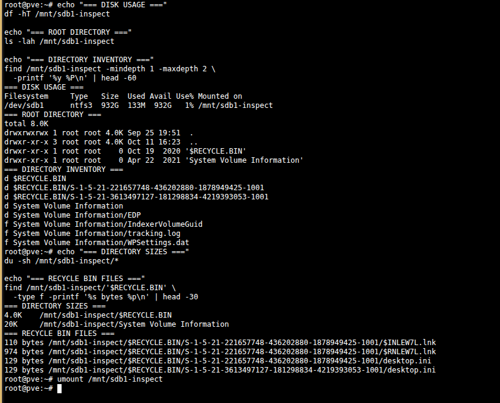

### 02 — Provision DFIR-01 and establish separate storage

- VM107 `DFIR-01`: Ubuntu 24.04.5 LTS, 2 vCPU, 4 GiB memory, SSD-backed 24 GiB OS disk, `vmbr0` management NIC.
- Ubuntu installer allocated ~11 GiB to `/`; extended `ubuntu-vg/ubuntu-lv` to ~22 GiB online.
- Installed package updates and QEMU Guest Agent. Initial static-unit/activation issue resolved after enabling the Proxmox guest-agent channel and restarting VM107; `qm agent 107 ping` then succeeded.
- Added 150 GiB HDD-backed VM disk, GPT partitioned, formatted ext4 with label `dfir-evidence`, and mounted at `/srv/velociraptor`; filesystem ~147 GiB total and ~140 GiB available on initial deployment.
- Persisted mount by filesystem UUID and validated unmount/remount. Installed `velociraptor` system identity, write-restricted `datastore/` and `filestore/`; `cases/` root-only. **Guest reboot persistence remains untested.**

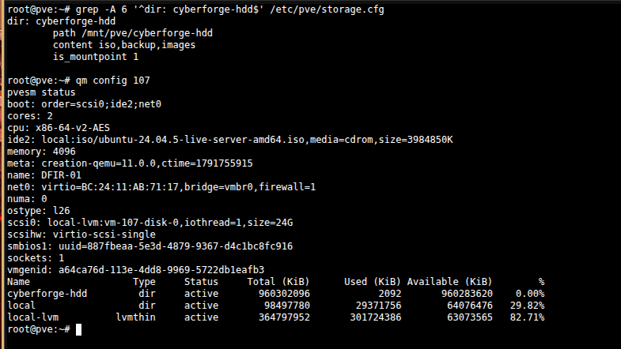
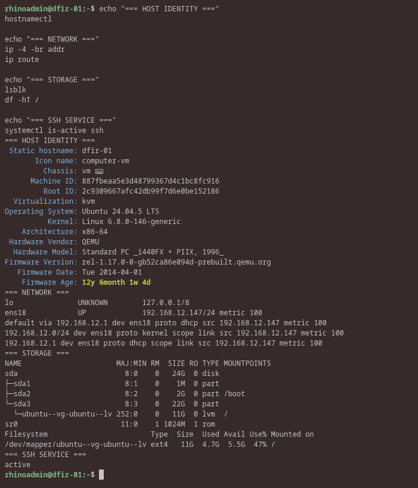
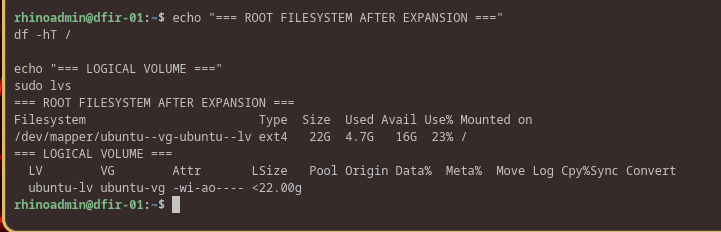
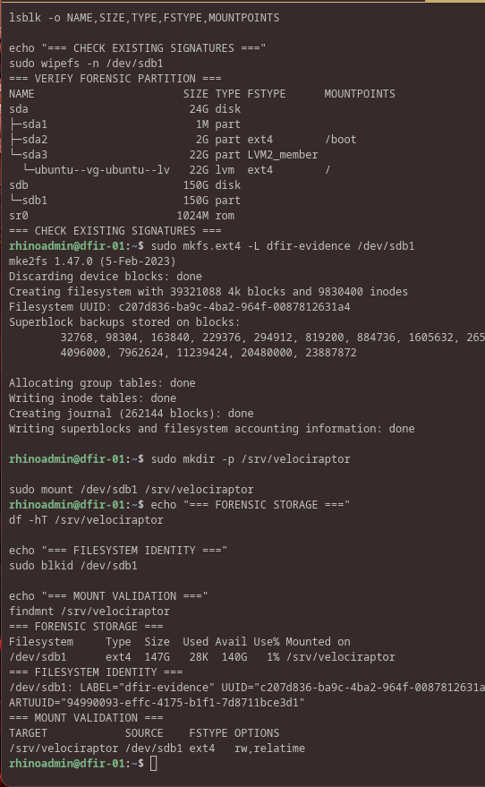
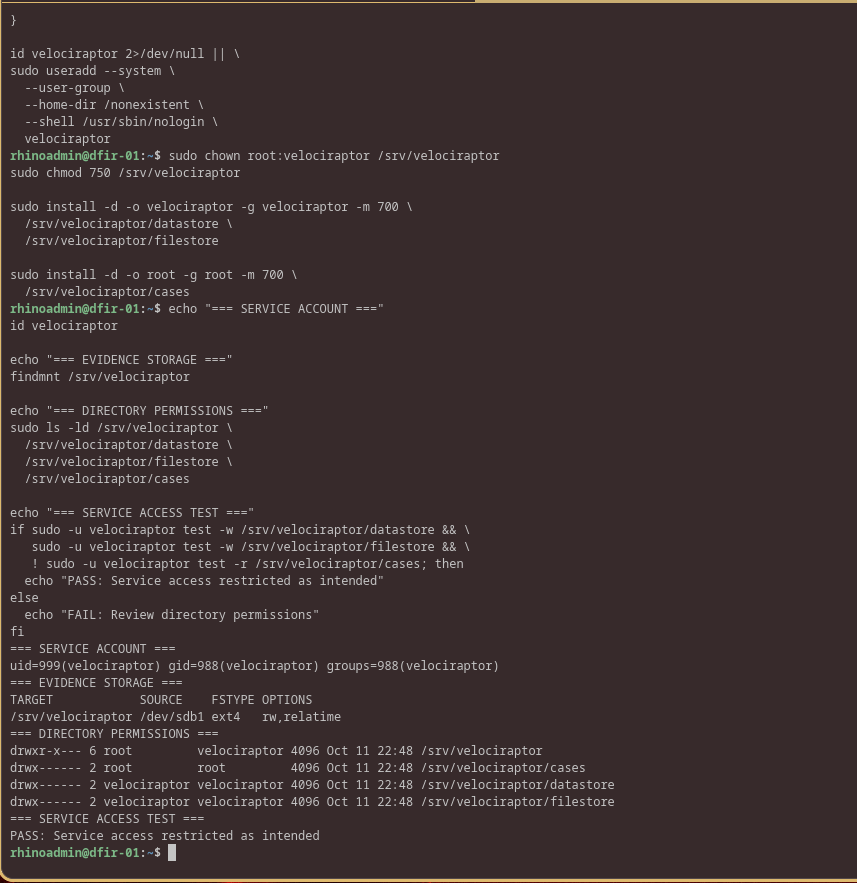

### 03 — Configure isolated DFIR networking

- Added VirtIO `ens19` on `vmbr20`, statically assigned **10.10.20.13/24** with no extra default route.
- Preserved management `ens18` **192.168.12.147/24**, default gateway `192.168.12.1`; confirmed ROUTER-01 ping **4/4**.
- Lab IP is for the Velociraptor HTTPS client frontend (`8000`); GUI is bound to **127.0.0.1:8889** and accessed from RhinoRecon via SSH local port `18889`.

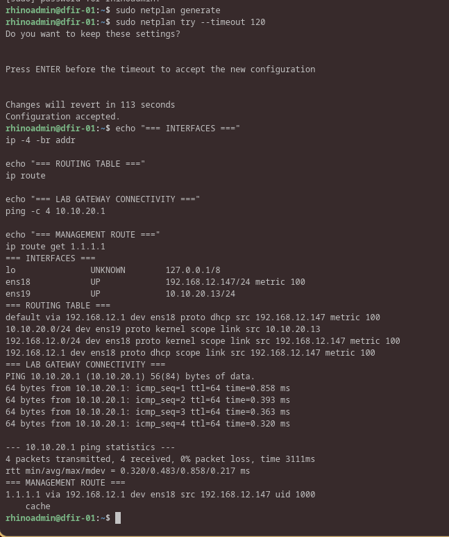

### 04 — Install and protect Velociraptor 0.77.3

- Downloaded the Linux AMD64 MUSL archive; release SHA-256 validation reported **OK** and binary printed version `0.77.3`.
- Wizard generated self-signed TLS settings. Initial `Frontend.bind_address=0.0.0.0` and duplicated datastore/filestore paths were caught before deployment.
- Attempted config merge as unprivileged user: failed `permission denied` while initializing datastore; the shell redirected zero-byte output over active config. Recovered 16,552-byte file from backup, verified matching SHA-256, then surgically corrected `Frontend.bind_address=10.10.20.13` and `Datastore.filestore_directory=/srv/velociraptor/filestore`.
- Built Velociraptor server Debian package. Initial `--output` filename attempt failed because the flag expects a **directory**; generated valid `velociraptor-server` 0.77.3 AMD64 `.deb` after correction.
- Inspected package systemd unit and `postinst` prior to install; installer auto-starts service. Created a systemd drop-in requiring the evidence mount and a deliberately absent authorization marker, then installed package without starting service.
- First authorized service start failed: missing `/var/log/velociraptor` for restricted service user. Created directory with correct ownership; retest passed. Confirmed **10.10.20.13:8000** and **127.0.0.1:8889** listeners; GUI authenticated through RhinoRecon SSH tunnel.

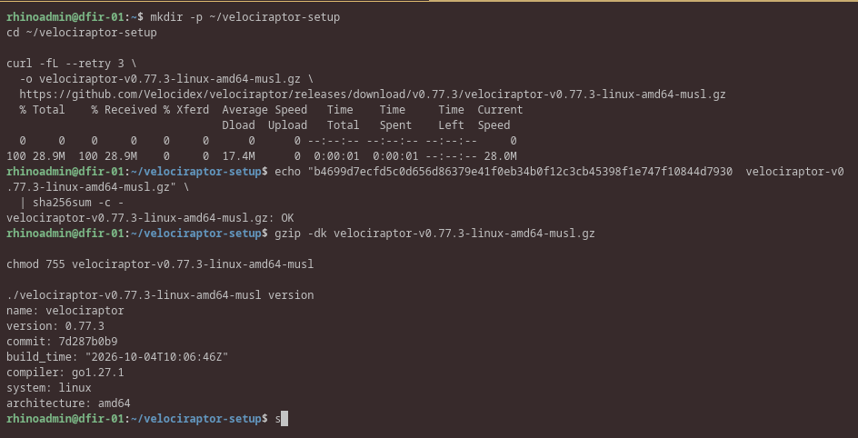
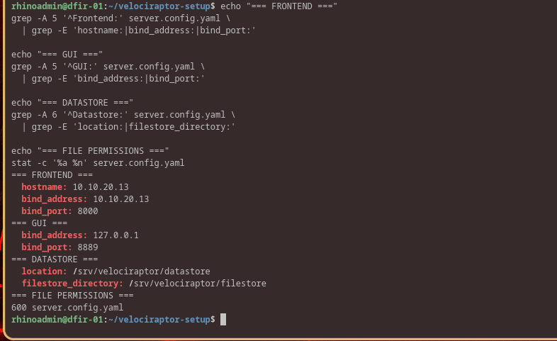
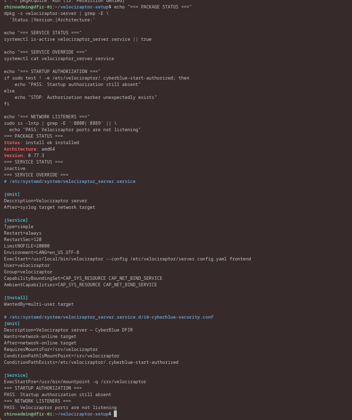
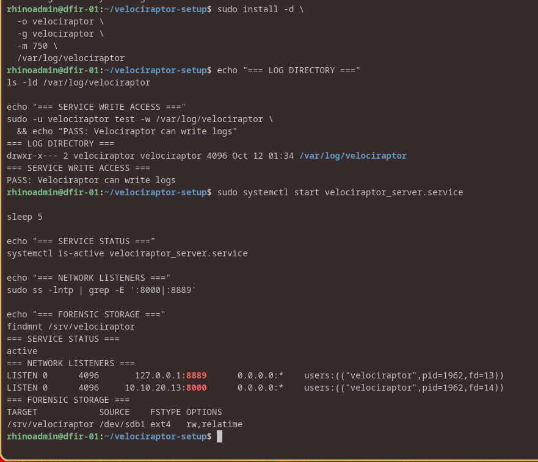
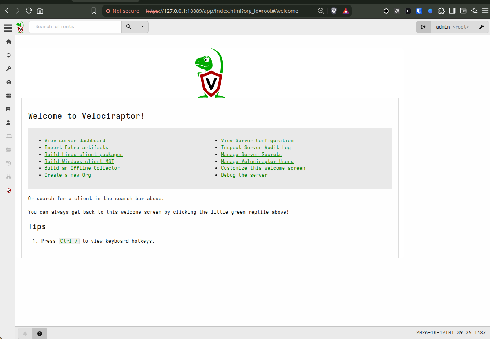

**Security note:** The private server YAML, embedded server keys and privileged installation `.deb` are deliberately **not** stored in this repository. The samples under `configs/` contain no private keys or passwords. The `ConditionPathExists` start gate was tested in its absent state, but a live mount-disappearance failure test is pending.

### 05 — Prepare Linux-Mint for initial enrollment

- A reachability test run mistakenly from PVE produced **0/4 ICMP replies** and SSH timeout. Retest from DFIR-01 proved **4/4 ICMP replies**, `8000` listener, and SSH login to `cyberadmin@10.10.20.11`.
- Server-side artifact `Server.Utils.CreateLinuxPackages` generated AMD64 Debian + RPM packages, but the overall collection returned **`Symbol Proxy not found`**. Uploaded Files proved the `.deb` exists; its contents and SHA-256 were checked separately.
- Debian package identified as `velociraptor-client` `0.77.3` `amd64`. Embedded `client.config.yaml` points to **https://10.10.20.13:8000/**, and `postinst` automatically enables/starts `velociraptor_client.service` upon installation.
- Transferred installer through authorized SSH hop to Linux-Mint; endpoint SHA-256 matched RhinoRecon copy. **The client was NOT installed**, enrolled, or used for artifact collection in this session.

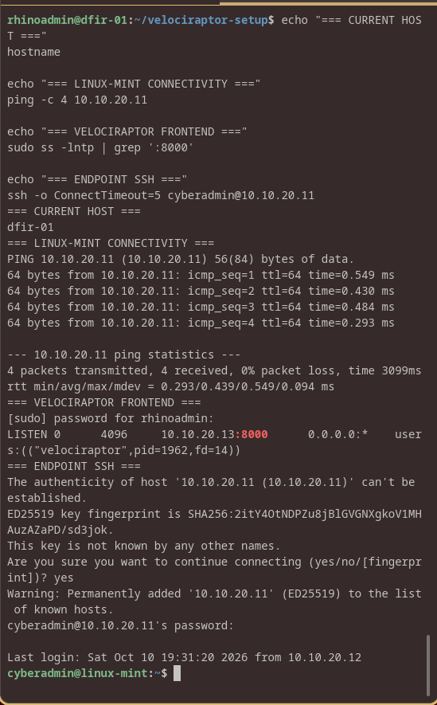
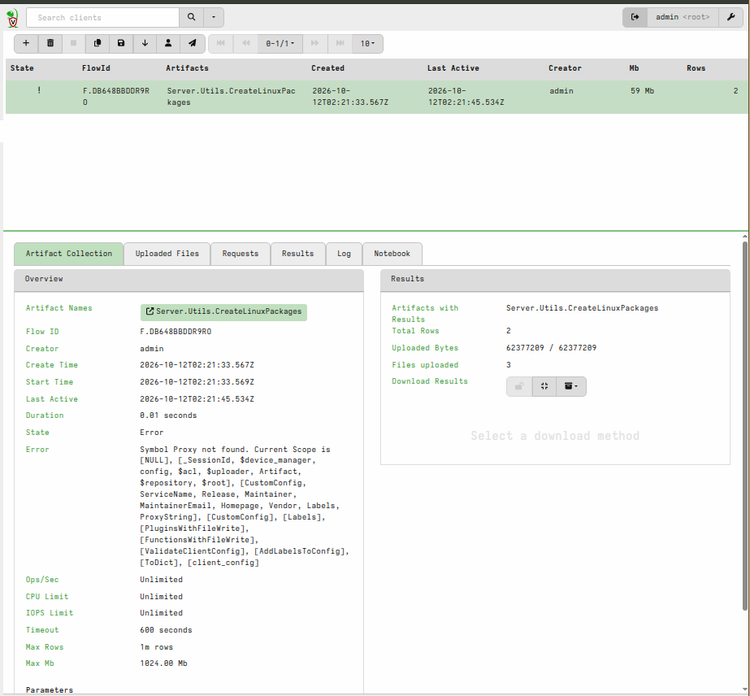
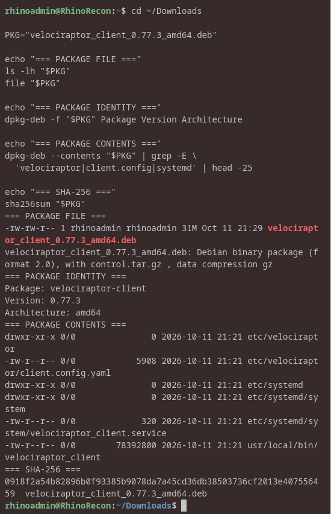
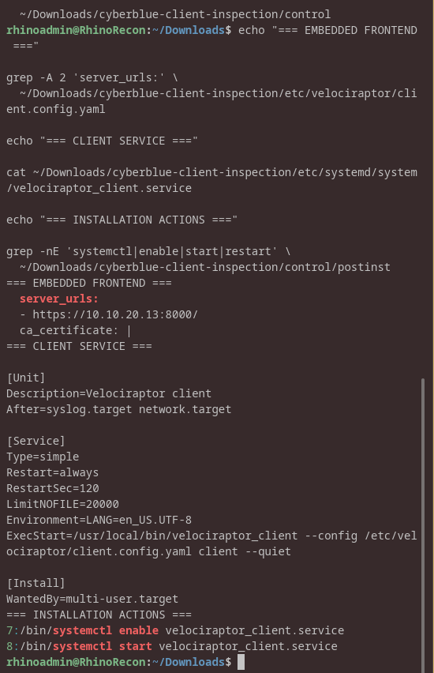
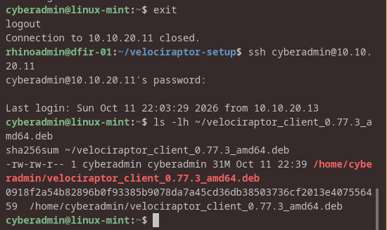

### 06 — Safely stop the range

- Gracefully stopped all eight known VMs, 100–107, verified each showed `stopped` in `qm list`.
- QEMU agent timeout messages occurred on some shutdown requests, but those VMs still reached `stopped` status.
- `sync` and `shutdown -h now` were issued on PVE. **Physical host power-off was not independently verified** in the screenshot.

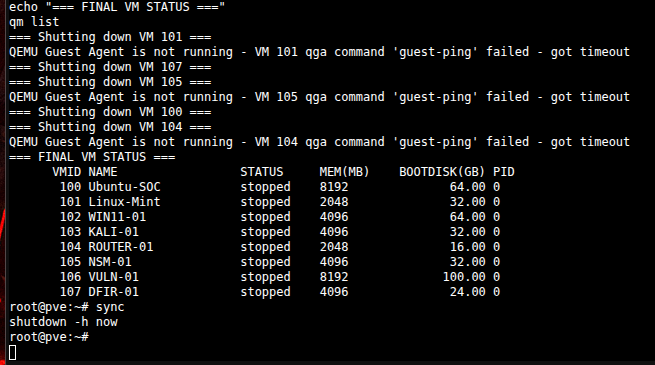

---

## Reproducible, sanitized implementation notes

- [Network Netplan](configs/dfir01-netplan-ens19.yaml) — additional lab interface without a default route.
- [systemd service drop-in](configs/velociraptor-server-guard.conf) — storage dependency and explicit first-start gate.
- [Storage and deployment commands](configs/DEPLOYMENT-NOTES.md) — sanitized repeatable checks, including client package inspection and SSH tunnel.
- [Chronological evidence manifest](EVIDENCE.md) — every included lab screenshot and its exact claim.

## Qualification and outstanding work

| Capability gate | Status | Evidence / next action |
|---|---|---|
| DFIR-01 VM, Ubuntu, QEMU agent | **PASS** | VM107 + SSH + agent proof |
| Dedicated mounted evidence storage and permissions | **PASS** | Disk/partition/ext4/fstab/remount/ACL test |
| Frontend/GUI network separation | **PASS** | Active listener `10.10.20.13:8000`, `127.0.0.1:8889` |
| Server package and protected startup | **PASS** | Installed 0.77.3; service running; startup gate tested absent |
| Linux client package integrity and transport | **PASS** | SHA-256 matched before/after transfer |
| Host reboot + automatic evidence-volume mounting | **NOT TESTED** | Reboot persistence qualification |
| Server restart when mount missing | **NOT TESTED** | Fail-closed regression under controlled outage |
| Administrator role review / least privilege | **PENDING** | Three GUI accounts created; review/admin governance |
| Linux-Mint agent enrollment | **PENDING** | Step 09.39; package staged only |
| Baseline Linux forensic artifact collection | **PENDING** | Prove evidence quality, time scope, integrity |
| Windows endpoint artifact collection | **PENDING** | VM102 / Sysmon / event logs |
| VM108 deliberately vulnerable target | **NOT DEPLOYED** | Isolated, authorized lab workload |
| Controlled attack, hunt, correlation, recovery | **NOT STARTED** | CTH-001 practical scenario |
| Client-ready findings report | **PENDING** | Include scope, findings, timestamps, confidence, limitations |
| **Module 09 Technical Build Gate** | **OPEN** | Requires collection, hunt, evidence, and replay |

### Next session starting point

1. Restore PVE, confirm `cyberforge-hdd` and DFIR-01 evidence mount are available **before** launching services.
2. Start DFIR-01, ROUTER-01, and Linux-Mint as appropriate; verify Velociraptor frontend and SSH management.
3. **Step 09.39:** Install staged Linux client package on VM101, confirm service healthy and client check-in on GUI.
4. Run initial benign Linux artifacts and capture a clean baseline before adding the intentionally vulnerable VM108.

Do not expose Velociraptor's self-signed GUI/frontend to the public Internet or use this training deployment for real client evidence without authorization, encryption and independent backup/recovery procedures.

## Principle / capability recap

The initial October 11 checkpoint documents the secured forensic platform and its deployment recovery. Since then, **Linux-Mint enrollment and successful baseline forensic artifact collections have been demonstrated**, and a restricted relay has been validated for physical Windows onboarding. **Windows enrollment, a controlled threat hunt, end-to-end recovery qualification, and the Module 09 technical build gate remain open.** See the [October 12 field progress and evidence](PROGRESS-2026-10-12.md).
